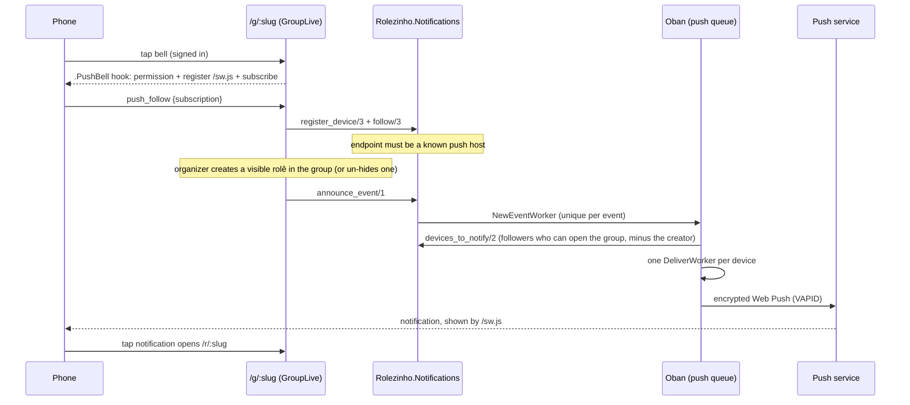

# Group Notifications

## Overview

Signed-in users can follow a group with the bell on its page and get a push
notification on their phone (or desktop browser) whenever a rolê is published in
it — even with the app closed. Anonymous visitors see the bell too; tapping it
asks them to sign in.

---

## Real Scenarios

> **Kelly** follows "Turma do Vôlei" from her Android phone. That evening the
> organizer posts "Treino de saque · 15/11 · 19h" in the group; Kelly's phone
> buzzes with "Novo rolê em Turma do Vôlei", and tapping it opens the rolê.

> **Diego** taps the bell on his iPhone in Safari. Instead of a prompt, a sheet
> shows how to add Rolezinho to the home screen; he does, opens the app from the
> new icon, taps the bell again and allows notifications.

> **Rafa** opens a group link without being signed in and taps the bell. A sheet
> offers "Entrar com GitHub" and "Entrar com e-mail"; after signing in he lands
> back on the same group and taps the bell to follow.

---

## Access Levels

| Level | Can |
| --- | --- |
| Anonymous visitor | See the bell on a group they can open; tapping it opens the sign-in sheet |
| Signed-in user | Follow and unfollow a group they can open; receive notifications on every device they enabled |
| Session with unlocked group | Required (for a password-protected group) to follow it and to keep receiving its notifications |
| Admin | Same as a signed-in user; the environment-password admin has no account, so can't follow |

A locked group shows no bell at all. See `SECURITY.md`, "Push notifications".

---

## App Journey

---

## The Bell

On `/g/:slug`, next to the group's name, once the group is open to the viewer.

| Situation | Tapping the bell |
| --- | --- |
| Not signed in | Opens the sign-in sheet: GitHub (`/auth/github?return_to=/g/:slug`) or e-mail (`/entrar?return_to=/g/:slug`) |
| iPhone/iPad, not opened from the home screen | Opens a sheet explaining how to add the app to the home screen |
| Browser without Web Push, or permission denied | Opens a sheet explaining notifications are unavailable |
| Signed in, not following | Asks for permission, registers this device, follows the group |
| Following | Unfollows (the bell is filled and blue while following) |

Following is per account; devices are per browser. A user who follows on the
phone and later opens the group on a laptop sees the bell as "following"; that
laptop receives nothing until the user unfollows and follows again from it.

---

## What Gets Announced

A rolê is announced when it becomes visible inside a group:

- created visible with a group, or
- un-hidden (the "Oculto" toggle turned off) while in a group.

It is announced once: the announcement job is unique per event for a day, so
hiding and showing it again doesn't repeat it. Nothing is announced for events
outside a group, hidden events, events moved into a group, or events that are no
longer open for signups by the time the job runs. The creator is never notified
about their own rolê.

The notification reads **"Novo rolê em <group>"** with **"<title> · <dd/mm · HHh>"**
(date omitted when there is none) and opens `/r/:slug`. It carries the real title
for password-protected groups too, since only people who can open the group get
it.

---

## Delivery

- `NewEventWorker` loads the event, re-checks it is still announceable, and
  enqueues one `DeliverWorker` per device of each follower who can still open
  the group.
- `DeliverWorker` sends one encrypted message (TTL one day). A device the push
  service reports gone (404/410) is deleted; other failures retry, up to five
  attempts.
- Finished jobs are pruned after a week.

---

## Live Behavior

The bell's state updates in place after following or unfollowing, with a flash.
Notifications themselves are outside the page: they arrive through the browser's
push service and the service worker, page open or not.

---

## Business Rules

- Only signed-in users follow groups or register devices.
- A password-protected group can be followed only by someone who can open it,
  and access is re-checked at send time.
- Push endpoints are accepted only on known browser push services over `https`.
- At most ten devices per account; registering more drops the oldest.
- Re-registering a browser's endpoint moves it to the current account.

---

## File References

| Type | File |
| --- | --- |
| Context | [notifications.ex](../../lib/rolezinho/notifications.ex) |
| Schema | [group_follow.ex](../../lib/rolezinho/notifications/group_follow.ex) |
| Schema | [push_subscription.ex](../../lib/rolezinho/notifications/push_subscription.ex) |
| Workers | [new_event_worker.ex](../../lib/rolezinho/notifications/new_event_worker.ex), [deliver_worker.ex](../../lib/rolezinho/notifications/deliver_worker.ex) |
| Sender | [pusher.ex](../../lib/rolezinho/notifications/pusher.ex), [web_push.ex](../../lib/rolezinho/notifications/web_push.ex) |
| Triggers | [events.ex](../../lib/rolezinho/events.ex) (`create/2`, `set_hidden/2`) |
| LiveView | [group_live.ex](../../lib/rolezinho_web/live/group_live.ex) |
| Service worker | [sw.js](../../priv/static/sw.js) |
| Migrations | [group_follows](../../priv/repo/migrations/20261112163856_create_group_follows.exs), [push_subscriptions](../../priv/repo/migrations/20261112163857_create_push_subscriptions.exs), [oban](../../priv/repo/migrations/20261112163855_add_oban_jobs_table.exs) |
| Tests | [notifications_test.exs](../../test/rolezinho/notifications_test.exs), [push_subscription_test.exs](../../test/rolezinho/notifications/push_subscription_test.exs), [group_push_bell_test.exs](../../test/rolezinho_web/live/group_push_bell_test.exs) |
| Decision | [ADR 0004](../decisions/0004-web-push-for-group-notifications.md) |
