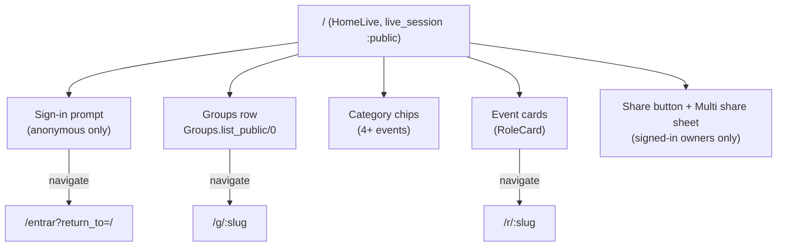

# Home Page

> Paired source: the membership pills below mirror `Rolezinho.Event.Membership.status/4`
> and `member_label/1` in
> [role_card.ex](../../lib/rolezinho_web/components/ui/role_card.ex). A change to one
> requires a change to the other in the same commit.
>
> Paired source: the share image's light palette in
> [share_image.js](../../assets/js/hooks/share_image.js) mirrors the `colors` frontmatter
> in `DESIGN.md`. A change to one requires a change to the other in the same commit.

## Overview

The home page (`/`) lists what is happening: public groups, public events, and every
event the viewer is part of. The viewer's own events stand out in blue with a pill
saying how they are involved ("Participando", "Na espera", "Organizando", or
"Caloteiro"). Signed-in organizers can also bundle their events into one message for a
group chat, or one image for a social post ("Multi share").

---

## Real Scenarios

> **Kelly** opens the app on her phone without signing in. She joined "Vôlei na praia"
> last week from this same phone, so it shows with a blue border and "Participando",
> next to the public events she is not on. A card at the top suggests signing in to
> keep track of her rolês across devices.

> **Tiago** runs three rolês and joined two others. Signed in, he sees all five in
> blue: "Organizando" on his own, "Participando" on the barbecue, and "Caloteiro" in
> red on the one that moved to "Só pagamentos" before he sent his Pix. The events from
> his "Turma do Vôlei" group come first, with the group's name on the card.

> **Marina** wants to remind her friends of everything she has open this week. She
> taps the share button, unticks the finished-but-not-closed karaokê, and pastes
> "Rolezinhos ativos" with three lines and links into the group chat.

> **Rafael** wants his followers to see what is on this month. In the same sheet he
> ticks "Gerar imagem", checks the preview — names, places, times, and "12/18" next to
> each — and taps "Compartilhar" to post the picture to his Instagram story.

---

## Access Levels

| Level | Can |
| --- | --- |
| Anonymous visitor | See public groups and public events; see the events they joined or organize from this device, marked in blue; see the sign-in prompt |
| Session with unlocked group | Additionally see their events inside that password-protected group |
| Signed-in user | Additionally see the events they created or joined while signed in, from any device; use Multi share for the events they created |
| Admin | Group password gates are open; otherwise the same as the levels above (an admin is not "on" every event) |

"Part of an event" is decided per event with the same identities the event page uses
(`Attendee.owns?/3`): the browser's participant token for that event's slug, or the
signed-in user id. Organizer status is holding the event's organizer token, or having
created it while signed in. See `SECURITY.md` for the access model.

---

## Screen Components



---

## Loading Strategy

`HomeLive.load_events/1` runs on mount and on every `:home_changed` message:

1. **Candidates.** `Events.list_home_for(user_id, device_slugs)` returns the public
   listing (`Events.list_open/0`) plus the viewer's own events, deduped, with the
   group preloaded. `device_slugs` are the slugs this browser holds a participant or
   organizer token for. Own events include hidden and grouped ones; `:done` events are
   never listed.
2. **Membership.** Each event gets `Membership.status/4` for the viewer.
3. **Gate.** An event stays only if it is public or the viewer has a membership. A
   device slug whose token doesn't match a row (stale or forged) proves nothing and
   lists nothing. A grouped event also needs its group open to the viewer
   (`Group.accessible?/4`); events in a locked group are dropped, as required by
   `SECURITY.md` §3.
4. **Order.** Grouped events first, by group name (case-insensitive), then ungrouped
   events. Within each, the query's order holds: by start date, undated last, then by
   title.

The groups row comes from `Groups.list_public/0` (public visibility, by name). It is
independent of the event list.

---

## Event Cards

Every event renders a `RoleCard`: category badge, title, date, avatars, "x/y
confirmados", and a progress bar. Grouped events add a badge with the group's name.

### Membership marks

When the viewer is part of the event, the card's border, category badge, and progress
bar turn blue (`info` token), and the status pill is replaced by the viewer's status.
When several apply, the most urgent wins, in this order:

| Status | Pill | When |
| --- | --- | --- |
| `:caloteiro` | Caloteiro (red) | The event is "Só pagamentos", the viewer has an unpaid main-list row, and that row owes something: never on a free event, and under "Dividir no final" only if the payment plan has the viewer sending money (see [split-method.md](split-method.md)) |
| `:participating` | Participando | The viewer has a row on the main list |
| `:waiting` | Na espera | The viewer has a row on the waiting list only |
| `:organizing` | Organizando | The viewer organizes the event and has no row |

Events the viewer is not part of keep the regular status pill ("Vagas abertas", "Lista
cheia", "Só pagamentos", "Averiguando Resenha", "Encerrado").

### Groups row

A group gets a blue icon tile when it holds at least one listed event the viewer is
part of; its "· com acesso" label turns blue as well. The marker is computed from the
already-gated event list, so a locked group never gets it. A password-protected group
shows "· com senha" when the viewer can't open it and "· com acesso" when they can.

---

## Category Filter

The chips appear once there are at least four events and at least one category.
"Todos" shows everything; a category chip filters the sorted list, so grouped events
stay first within each category.

---

## Sign-in Prompt

Anonymous visitors see a card under the header — "Faça login para acompanhar seus
rolezinhos facilmente" — with an "Entrar" button to `/entrar?return_to=/`. Signed-in
users don't see it. Anonymous membership works without signing in, but only on the
device that holds the tokens; signing in makes it follow the account.

---

## Multi Share

A share button in the header, for signed-in users who created at least one shareable
event. It opens a sheet listing those events, all checked by default. Below the list,
the "Gerar imagem" checkbox picks the output: a text message (default) or an image.
Both follow the same selection.

- **Which events:** `Events.list_shareable_for/1` — created by the user and not
  `:done`, hidden and grouped included — minus events inside a group the viewer can't
  currently open, so their titles never reach the page.
- **Selection** is kept on the server. A toggled id is honored only if it belongs to
  the viewer's shareable events, so a forged id can't pull someone else's event into
  the output.

### Text

A live preview of the message with "Copiar" / "Compartilhar" actions.

- **Passwords:** "Incluir as senhas no texto" appears when one of the events has a
  password. Passwords are part of the page only while it is checked.
- **Message** (`Rolezinho.MultiShare.to_text/3`):

```text
Rolezinhos ativos

* Vôlei: 12/18. https://rolezinho.lubien.dev/r/volei
* Churras: Apenas pagamentos 11/12. https://rolezinho.lubien.dev/r/churras
* Coworking: Averiguando Resenha 03/08. https://rolezinho.lubien.dev/r/coworking Senha: fofoca
```

Counts are zero-padded to two digits: filled/capacity, or paid/filled under
"Apenas pagamentos".

### Image

A preview of a 1080x1350 (4:5) PNG with "Baixar" / "Compartilhar" actions.
"Compartilhar" opens the system share sheet with the file where the browser can share
files, and downloads it otherwise.

- **Rows** (`Rolezinho.MultiShare.to_image_rows/1`): title, place, start time
  ("Sex, 04/12 · 19h", minutes only when not on the hour, read in Brasília), the count,
  and a status tag ("Apenas pagamentos" or "Averiguando Resenha"). The count follows the
  text: filled/capacity, or paid/filled under "Apenas pagamentos".
- **Public by design:** the image is meant for social posts, so it never carries a
  password, and a password-protected event leaves its place out — the place is part of
  what the password gates. The password checkbox is hidden while "Gerar imagem" is on.
- **Drawing** happens in the browser, in the `ShareImage` hook, on a `<canvas>`: the
  "Rolezinhos" title with the logo and the app's host, a card with one row per event,
  and the footer "Feito com [heart] em <host>", the heart drawn in the accent color. Always in the light palette, whatever the
  viewer's theme.
- **Layout by size:** up to three rows get a roomy layout (larger type, place and time
  on separate lines); four to seven share one compact meta line; eight or more show six
  rows plus "+N rolezinhos". Long titles end in "…".

```text
+-----------------------------------+
| [logo]                            |
| Rolezinhos                        |
| rolezinho.lubien.dev              |
|                                   |
|  +-----------------------------+  |
|  | Vôlei de quinta     (12/18) |  |
|  | Quadra do Ibirapuera        |  |
|  | Sex, 04/12 · 19h            |  |
|  |-----------------------------|  |
|  | Churras de fim...   (24/24) |  |
|  | ...                         |  |
|  +-----------------------------+  |
|                                   |
|  Feito com [heart] em rolezin...  |
+-----------------------------------+
```

---

## Live Behavior

`HomeLive` subscribes to `events:home` when connected. Event writes (create, save,
status, visibility, password, slug, group changes, deletion) and group writes
broadcast `:home_changed`, and the page reloads its lists: new events appear, finished
ones leave, membership pills and progress bars update, and the Multi share list keeps
the current selection (dropping events that stopped being shareable, adding new ones
checked).

---

## Business Rules

- `:done` events never appear on the home page.
- A grouped event appears only for viewers who are part of it and can open its group;
  the public listing never includes grouped events.
- Device tokens are candidates, not proof: an event is listed through them only when
  the token matches a row or the organizer token.
- Blue (`info`) means "the viewer is part of this", on cards and on groups alike.
- Order: grouped events by group name, then ungrouped, each by date.
- The Multi share image never carries a password, nor the place of a
  password-protected event.

---

## File References

| Type | File |
| --- | --- |
| LiveView | [home_live.ex](../../lib/rolezinho_web/live/home_live.ex) |
| Context | [events.ex](../../lib/rolezinho/events.ex) |
| Context | [groups.ex](../../lib/rolezinho/groups.ex) |
| Membership | [membership.ex](../../lib/rolezinho/event/membership.ex) |
| Multi share text and image rows | [multi_share.ex](../../lib/rolezinho/multi_share.ex) |
| Multi share image drawing | [share_image.js](../../assets/js/hooks/share_image.js) |
| Group access | [group.ex](../../lib/rolezinho/group.ex) |
| Device tokens | [participant.ex](../../lib/rolezinho_web/plugs/participant.ex) |
| Component | [role_card.ex](../../lib/rolezinho_web/components/ui/role_card.ex) |
| Component | [status_pill.ex](../../lib/rolezinho_web/components/ui/status_pill.ex) |
| Component | [progress_bar.ex](../../lib/rolezinho_web/components/ui/progress_bar.ex) |
| Tests | [home_live_test.exs](../../test/rolezinho_web/live/home_live_test.exs) |
| Tests | [home_my_events_test.exs](../../test/rolezinho_web/live/home_my_events_test.exs) |
| Tests | [home_membership_test.exs](../../test/rolezinho_web/live/home_membership_test.exs) |
| Tests | [home_multi_share_test.exs](../../test/rolezinho_web/live/home_multi_share_test.exs) |
| Tests | [group_home_listing_test.exs](../../test/rolezinho_web/live/group_home_listing_test.exs) |
| Tests | [membership_test.exs](../../test/rolezinho/event/membership_test.exs) |
| Tests | [multi_share_test.exs](../../test/rolezinho/multi_share_test.exs) |
| Tests | [events_shareable_test.exs](../../test/rolezinho/events_shareable_test.exs) |
