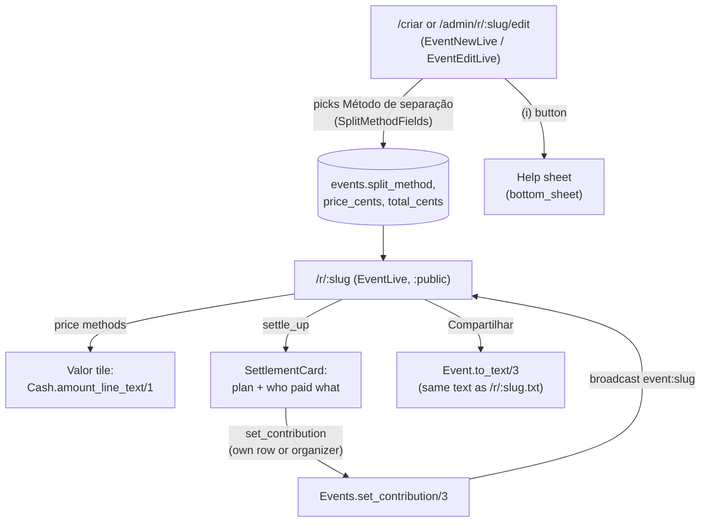

# Split Method (Método de separação)

> Paired source: the method table below mirrors `Event.split_methods/0` and
> `Event.split_method_label/1` in [event.ex](../../lib/rolezinho/event.ex). A change
> to one requires a change to the other in the same commit.

## Overview

Every event has a split method that decides how its cost is divided among the people
on the main list. Three methods start from an amount the organizer types (a total, or
a price per person); the fourth, "Dividir no final", has no price: each attendee
records what they spent, and the app builds a payment plan that tells who sends how
much to whom so everyone ends even.

---

## Real Scenarios

> **Tiago** rents a barbecue spot for R$ 300 and doesn't know yet how many friends will
> come. He picks "Dividir automaticamente total" and types 300. With 12 people on the
> list each owes R$ 25; when Kelly joins as the 13th, the page and the shared text show
> R$ 23,08 without Tiago touching anything.

> **Marina** books an 18-person futsal court at R$ 15 a head. She picks "Preço por
> participante (inclui vazios)": with 12 confirmed and 8 paid, her banner reads
> "Faltam R$ 150 · 4 pessoas não pagaram o Pix · 6 vagas vazias (R$ 90)", so she knows
> she is out of pocket for the empty seats too.

> **Ana** paid R$ 200 for the meat and **Bruno** R$ 120 for drinks at a weekend at the
> sítio with 10 people. The event uses "Dividir no final". Each of them types what they
> spent on their own row and leaves a Pix key. The shared message lists eight transfers
> ("Hugo manda R$ 8 para Ana e R$ 24 para Bruno") and both keys; as people send their
> part they mark "Pago" and get a ✅ in the plan.

---

## Access Levels

| Level | Can |
| --- | --- |
| Anonymous visitor | See the amount line and, on an event that isn't password-protected, the payment plan and receivers' Pix keys |
| Session with unlocked event | Same as above on a password-protected event |
| Participant (owns a row) | Record what they spent and their Pix key on their own row; mark their own row paid |
| Organizer (creator or `organizer_token`) | Choose the method and amount on create/edit; record spending and Pix keys on any row; mark any row paid; see the outstanding banner |
| Admin | Everything the organizer can |

Ownership and the organizer role are the ones described in `SECURITY.md` and
`Event.Policy`. Recording spending follows the paid-check rule
(`Policy.can_toggle_paid?/3`) and is re-checked in the handler.

---

## Methods

| Method (`split_method`) | Label | Amount field | What each person owes |
| --- | --- | --- | --- |
| `:total_split` | Dividir automaticamente total | Total do rolê (`total_cents`) | total ÷ people on the main list, rounded up to the cent |
| `:per_person` (default) | Preço por participante | Quanto cada um paga (`price_cents`) | the price |
| `:per_seat` | Preço por participante (inclui vazios) | Quanto cada um paga (`price_cents`) | the price; empty seats count as missing money |
| `:settle_up` | Dividir no final | none | their equal share of what everyone spent, settled through the payment plan |

Only the main list counts. The waiting list never owes anything.

---

## App Journey

---

## Choosing the method

The create form (`/criar`) and the edit form (`/admin/r/:slug/edit`) render
`SplitMethodFields`: a select with the four labels, an info button that opens a sheet
explaining each option with one example, and an amount field that follows the
selection (the form's `phx-change` swaps it). "Dividir no final" shows a short note
instead of an amount field.

- Unknown method strings fall back to `:per_person`; atoms are never built from params.
- When an update omits `split_method` or `total`, the stored values are kept.
- `price` is cleared when the submitted form has no price field (switching to a method
  without one).

---

## Dividir no final

### Recording spending

On the event page, the "Dividir no final" card lists everyone on the main list with
what they spent and their balance ("recebe R$ 168", "manda R$ 32", "mandou ✅",
"quite"). Rows the viewer may edit carry an inline form:

- **Amount**: free-form ("200", "R$ 32,50"); blank means zero; at most R$ 100.000.
- **Pix key**: shown once the row has spent something. Optional, stored as typed, and
  accepted only if it has the shape of a Pix key (`Pix.classify/1`), up to 100
  characters. Leaving the field out of a submission keeps the stored key; submitting it
  blank clears it.

### The payment plan

`Rolezinho.Event.Settlement.plan/1` builds the plan from the main list:

1. The total is the sum of what everyone spent.
2. Each person's share is total ÷ people. Amounts are integer cents; leftover cents go
   one each to the first people on the list, so shares add up to the total exactly.
3. Balance = spent − share. Positive balances receive, negative balances send. Someone
   who spent less than their share sends the difference; someone who spent exactly
   their share is out of the plan.
4. Transfers pair the largest debt with the largest credit, repeatedly. That takes at
   most `people − 1` transfers; ties keep list order.

Worked example: Ana R$ 200, Bruno R$ 120, 8 others R$ 0 → R$ 32 each. Ana receives
R$ 168, Bruno R$ 88, the other eight send R$ 32; Hugo's R$ 32 is split R$ 8 to Ana
and R$ 24 to Bruno.

The plan is derived on every render and never stored. When the list or anyone's
spending changes, the plan changes with it; `paid` marks are kept. The reasoning is in
[ADR 0003](../decisions/0003-settle-up-payment-plan.md).

### Paid marks

"Paid" on a sender means "says they sent their part", toggled with the existing "Pago"
row action. The card strikes through that sender's transfers and the shared text adds
✅. Paid marks on receivers have no effect on the plan.

---

## Live Behavior

Every write (spending, Pix key, paid toggle, joining or leaving) goes through
`Events.save/1`, which broadcasts on `event:<slug>`. Anyone with the page open sees
the amount line, the plan, the balances, and the receivers' keys update without
reloading. Under `:total_split`, a join changes everyone's per-person amount the same
way.

---

## Outputs

| Output | Price methods | Dividir no final |
| --- | --- | --- |
| Page (`/r/<slug>`) | "Valor" tile with `Cash.amount_line_text/1`, e.g. "Total R$ 300 · R$ 25 por pessoa" | The card: total, share, plan, who paid what, receivers' Pix keys |
| Text (`/r/<slug>.txt` and Compartilhar) | Amount line after the header | Amount line ("Dividir no final · Total R$ 320 · R$ 32 por pessoa"), a "Plano de pagamento" block with one line per sender and ✅ for those who sent, a "Pix de quem recebe" block, and "(pagou R$ X)" next to contributors in the list |
| Calendar (`/r/<slug>/calendar.ics`) | No amounts | No amounts |

On a password-protected event that hasn't been unlocked, the text omits the amount
line (with the description) and the plan and Pix keys (with the names), and the page
does not render the card. The gate is on the server, per `SECURITY.md` §3.

---

## Business Rules

- Existing events and new events default to `:per_person`.
- All amounts come from `Rolezinho.Event.Cash`; the page, payment screen, join
  redirect, reminder, and text never read `price_cents` directly.
- `:total_split` rounds the per-person amount up, so the organizer may collect a few
  cents over the total but never under it. With nobody on the list there is no
  per-person amount, only the total.
- `:per_seat` reports empty seats separately from people who owe, in the organizer's
  outstanding banner.
- `:settle_up` has no per-person price: the payment screen (`/r/<slug>/pagamento`) is
  not offered after joining, and the WhatsApp reminder leaves out the organizer's Pix,
  since people pay each other.
- The plan and Pix keys are shown only to viewers who can see names.

---

## File References

| Type | File |
| --- | --- |
| Schema | [event.ex](../../lib/rolezinho/event.ex) |
| Schema | [attendee.ex](../../lib/rolezinho/event/attendee.ex) |
| Context | [events.ex](../../lib/rolezinho/events.ex) |
| Amounts | [cash.ex](../../lib/rolezinho/event/cash.ex) |
| Payment plan | [settlement.ex](../../lib/rolezinho/event/settlement.ex) |
| Policy | [policy.ex](../../lib/rolezinho/event/policy.ex) |
| LiveView | [event_live.ex](../../lib/rolezinho_web/live/event_live.ex) |
| LiveView | [event_new_live.ex](../../lib/rolezinho_web/live/event_new_live.ex) |
| LiveView | [event_edit_live.ex](../../lib/rolezinho_web/live/event_edit_live.ex) |
| Component | [split_method_fields.ex](../../lib/rolezinho_web/components/ui/split_method_fields.ex) |
| Component | [settlement_card.ex](../../lib/rolezinho_web/components/ui/settlement_card.ex) |
| Migration | [20261104184936_add_split_method_to_events.exs](../../priv/repo/migrations/20261104184936_add_split_method_to_events.exs) |
| Tests | [cash_split_method_test.exs](../../test/rolezinho/event/cash_split_method_test.exs) |
| Tests | [settlement_test.exs](../../test/rolezinho/event/settlement_test.exs) |
| Tests | [settle_up_text_test.exs](../../test/rolezinho/event/settle_up_text_test.exs) |
| Tests | [events_split_method_test.exs](../../test/rolezinho/events_split_method_test.exs) |
| Tests | [split_method_form_test.exs](../../test/rolezinho_web/live/split_method_form_test.exs) |
| Tests | [settle_up_test.exs](../../test/rolezinho_web/live/settle_up_test.exs) |
